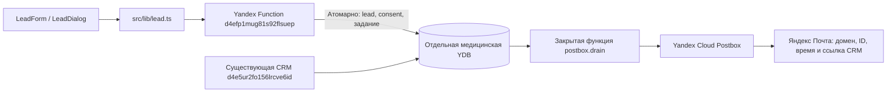

# Карта проекта Medecina

Проверено по локальным исходникам 28 октября 2026 года. Назначение: быстро выбрать
файлы для конкретной задачи, не перечитывая весь проект. Подробности передачи:
`../ПЕРЕДАЧА_ПРОЕКТА_АГЕНТУ.md`.

27.10.2026 сайт опубликован на `https://promedphoto.ru/` с HTTPS. Форма → отдельная
медицинская YDB → общая CRM и уведомление Telegram проверены реальной отправкой
вымышленных данных. Текущие версии, подтверждения и состояние мониторинга:
[отчёт выпуска](RELEASE-2026-10-27.md). Предыдущая диагностика YDB сохранена отдельно
как исторический снимок.

28.10.2026 опубликованы лёгкие тени фотографий и уточнённый морфинг четырёх
медицинских объектов: плавные подписи на компьютере, компактный iPad без подписей,
без управления паузой; круги и свечение подвала сдвинуты вправо. На ширинах
820 и 390 px объекты скрыты. Подтверждения оформления:
[последний выпуск 28 октября](RELEASE-2026-10-28-FOOTER-POLISH.md).

В commit `8322b8b` опубликованы значки Instagram, Профи.ру и ВКонтакте;
на компьютере в одну линию справа от географии, на телефонах под ней.
[Выпуск социальных ссылок](RELEASE-2026-10-28-SOCIALS.md).
Ранее исправлен сплошной фон поля телефона, включая префикс и автозаполнение.
[Выпуск формы](RELEASE-2026-10-28-PHONE-FILL.md).
[План индексации](SEARCH-INDEXING.md) и пакет output/search-indexing-2026-10-28/
подготовлены отдельно. 03.11.2026 Google подтвердил права через TXT в Timeweb
и обработал карту со всеми 14 адресами. [Статус Google](GOOGLE-VERIFICATION-2026-10-28.md).
03.11.2026 Яндекс Вебмастер подтвердил права владельца по метатегу. 10 из 14
поисковых страниц поставлены в очередь переобхода. Статус карты и оставшиеся
адреса указаны в [плане индексации](SEARCH-INDEXING.md#статус-яндекс-вебмастера-на-3-ноября-2026).
[Проверка HTTPS и случая Билайна](HTTPS-AND-BEELINE.md): Enforce HTTPS включён,
сертификат действителен; причина ERR_CONNECTION_CLOSED в мобильной сети не установлена.

## Страницы сайта

Commit `53846ab` от 18.11.2026 добавляет уведомление о хранилище вкладки,
кнопки возврата на главную на юридических страницах и уточняет раздел 11 политики
в редакции `2026-11-18-medical-policy-1`. Открытие политики из плашки,
возврат на первый экран и закрытие плашки проверены на 393 и 1440 px.
Хеши всех 20 файлов совпали со сборкой на рабочем домене.
[Публикация GitHub Pages](https://github.com/kuznetsovphotographer-prog/Photo-Medecina/actions/runs/44304797310).

Commit `401c27f` от 17.11.2026 публикует уточнения политики обработки
данных, редакция `2026-11-17-medical-policy-1`.
[Выпуск и проверки](CONSENT-AUDIT-2026-11-17.md#выпуск-17-ноября-2026-года).
Commit `f9945f2` от 07.11.2026 убирает подсказку со стрелки «Наверх»
в меню. Круг кнопки телефона плавно закрашивается до конца после короткого
касания или клика.
[Публикация GitHub Pages](https://github.com/kuznetsovphotographer-prog/Photo-Medecina/actions/runs/42357598386).
В commit `3ad3aa2` от 03.11.2026 добавлен метатег Яндекс Вебмастера
в 14 страниц из карты сайта. В commit `7d03d29` от 30.10.2026 обложки услуг и серий
открывают первую фотографию общей галереи, повтор обложки в сетке не дублируется
в просмотре; плюсик плавно увеличивается при наведении.
[Выпуск и проверки](RELEASE-2026-10-30-HERO-GALLERY.md).

| Адрес / область | Точка входа | Данные / зависимости |
| --- | --- | --- |
| Главная `/` | `src/pages/index.astro` | `src/data/content.ts`, `src/data/service-stories.ts` |
| Услуга `/uslugi/<slug>/` | `src/pages/uslugi/[slug].astro` | `services` в `content.ts`, `package-details.ts` |
| Серия `/proekty/<slug>/` | `src/pages/proekty/[slug].astro` | `projects` в `content.ts`, `projectGalleryPhotos` в `src/lib/photos.ts` |
| Политика, согласие | `src/pages/privacy.astro`, `consent.astro` | `src/components/LegalDocument.astro`, `src/data/legal-documents.json` |
| Благодарность, 404 | `src/pages/thankyou.astro`, `404.astro` | Общий layout |
| SEO, robots, sitemap | `astro.config.mjs`, `src/lib/site.ts`, `src/pages/robots.txt.ts`, `sitemap.xml.ts` | `SEO_MODE`, `SITE_URL` |
| Общая оболочка | `src/layouts/BaseLayout.astro` | Header, Footer, Lightbox, LeadDialog, LegalDialog; подключение общих CSS и скриптов |

Шесть услуг: `portrety-vrachey`, `komandnaya-semka`, `reklamnaya-semka`,
`oborudovanie`, `interery`, `studiynaya-semka`. Семь серий: `dental-smile`,
`satori-dent`, `simpla-dental`, `weeksmile`, `zubfeya`, `pavel-anesteziolog`, `stomalina`.

## Где что менять

| Задача | Нужные файлы |
| --- | --- |
| Тексты услуг, проектов, цены, FAQ | `src/data/content.ts`, `service-stories.ts`, `package-details.ts` |
| Шапка, подвал, контакты | `src/components/Header.astro`, `Footer.astro`, `ContactLinks.tsx`, `ContactIcon.tsx` |
| Социальные ссылки подвала | `src/components/FooterSocialLinks.astro`: Instagram, Профи.ру, ВКонтакте; стили внутри компонента, размещение рядом с географией в `Footer.astro` |
| Форма и модальное окно заявки | `src/components/LeadForm.tsx`, `LeadDialog.tsx`, `Inquiry.astro`; `src/lib/lead.ts` |
| Согласие и юридические окна | `src/data/legal-documents.json`, `src/components/LegalDocument.astro`, `LegalDialog.astro`, `src/scripts/legal-dialog.ts`; версия в `src/lib/lead.ts` |
| Уведомление о хранилище вкладки | `src/components/BrowserStorageNotice.astro`; раздел 11 политики и локальный предпросмотр `/?show-notice=1` в режиме разработки |
| Фото, порядок серий, кадрирование | `src/lib/photos.ts`, `src/data/photos.json`, `gallery-stages.json`, `photo-framing.json`, `cover.json`, `src/components/Photo.astro` |
| Просмотр фото и жесты | `src/components/Lightbox.astro`, `src/scripts/gallery-swipe.ts`, `src/styles/gallery.css` |
| Возврат к месту на главной | `src/scripts/home-return.ts` |
| Подсказки, FAQ, заголовки | `src/scripts/icon-tooltips.ts`, `faq.ts`, `service-headings.ts`, `service-links.ts` |
| Типографика и мобильные интервалы | `src/styles/typography.css`, `mobile-rhythm.css`, `global.css` |
| Остальное оформление | Тематические файлы в `src/styles/`; порядок общих импортов в `BaseLayout.astro` |
| Медицинские миниатюры | `src/components/MedicalFigure.tsx`, `src/lib/medical-figures/`, `src/data/medical-figure-framing.json` |
| Фон и анимации | `ScientificBackdrop.tsx`, `ParticleField.tsx`, `ExposureField.tsx`, `LiveViewCharacter.tsx`, `HeroSignal.astro`, `SectionPulse.astro`, `InnerGraphics.astro` |
| Голубые волны, эксперимент отключён 28.10 по запросу владельца | Пять Astro-файлов восстановлены; исходники эффекта сохранены в `output/gradient-waves-local/archived-sources/`. История: `docs/LOCAL-GRADIENT-WAVES.md`. |
| Лёгкая тень на фотографиях, опубликована 28.10 | `src/styles/media-previews.css`; выбрана из отдельного локального `output/photo-depth-lab/index.html`. История и резервная копия: `docs/LOCAL-PHOTO-DEPTH.md`. |
| Четыре вращающихся медицинских объекта у заголовка подвала | `src/components/MedicalMorph.tsx`, `src/lib/medical-morph.ts`, `src/styles/medical-morph.css`; подключение и якорь подписи в `Footer.astro`. Компьютерные подписи, компактный iPad без подписей и удаление остановки опубликованы: `docs/RELEASE-2026-10-28-FOOTER-POLISH.md`. Скрыты ниже 1024 px. |
| Подготовка изображений | `scripts/prepare-assets.py`, `refresh-project-photos.py`, `migrate-photo-seo.py` |
| Подготовка GitHub Pages | `scripts/prepare-github-pages.mjs` — выходные копии в `output/` |
| Индексация и подтверждение домена | `docs/SEARCH-INDEXING.md`, `scripts/audit-search-readiness.mjs`, `prepare-site-verification.mjs`; подготовленный архив в output. Файлы подтверждения выдаются кабинетами владельца. |

Оригиналы находятся в `Оригинальные фото/`, промежуточные AVIF — в `Avif/` и
`Avif-mobile/`, публикуемые файлы — в `public/media/`. Наличие нескольких копий
не означает, что их можно удалять. Для состава галереи сначала проследите
`projectGalleryPhotos` и идентификаторы фотографий.

## Интеграция заявки и CRM



18.11.2026 выпущены медицинский приёмник `d4er5imo0euvv15hu727` и закрытый
отправитель `d4ecj3o5uk3muftkipu1`; GET подтвердил `deliveryMode:postbox`,
`databaseChecked:true`. Минутный таймер активен. Обновлённые документы опубликованы
commit `779804138834a06901194cd3cf3c38f92f311a3b`, Pages run `44308344468` success.
Синтетическая заявка `317e6faa-7511-46e1-944d-9b5e6aa31277` сохранена с согласием
и outbox; Delivery в 15:57:48 МСК, письмо и открытие защищённой CRM-карточки подтверждены.
[Текущее состояние выпуска](POSTBOX-RELEASE-2026-11-18.md).
Секреты и персональные данные не входят в Graphify.

| Подсистема | Код | Документ / проверка |
| --- | --- | --- |
| Клиентский контракт | `src/lib/lead.ts` | `scripts/check-lead.mjs` |
| Новая функция приёма | `integration/yandex/lead-function/index.js`, `validation.js`, `storage.js` | README и `*.test.cjs` в той же папке |
| Отправитель Postbox | `integration/yandex/lead-function/postbox.js`, `postbox-store.js` | Закрытая `promedphoto-postbox`, `postbox.drain`; отдельный минутный таймер |
| Сохранённый Worker | `integration/cloudflare/lead-worker/src/index.ts`, `notification.ts`, `monitor.ts` | Новые заявки в режиме Postbox его не вызывают; код и посетительские ссылки сохранены |
| Копия существующей CRM | `integration/crm/function/index.js`, `crm-storage.js`, `storage.js` | Сначала `integration/crm/AGENTS.md`; это отдельная зона ответственности |
| Интерфейс и авторизация CRM | `integration/crm/function/admin-page.js`, `admin-auth.js` | UI частично находится внутри строк: AST-граф не раскрывает всю логику |
| Локальный стенд CRM | `integration/crm/preview-server.cjs` | `npm.cmd run preview` из `integration/crm`; вымышленные данные |
| Ресурсы и результаты диагностики | `docs/DOMAIN-AND-LEADS.md`, `integration/README.md` | Исторические сведения сверять перед выпуском |

В `src/lib/lead.ts` отдельный endpoint `d4efp1mug81s92flsuep`, опубликованная версия
согласия — `2026-11-18-medical-postbox-1`; сервер принимает также
`2026-10-27-medical-1` для уже открытых форм. Результаты — в отчёте Postbox.
Исторические тайм-ауты YDB при повторной проверке не
воспроизвелись. После будущих изменений проверять фактический production заново.
17.11.2026 сверены активные медицинский приёмник, Worker и адаптер CRM.
Опубликована редакция политики `2026-11-17-medical-policy-1` с
уточнениями роли Cloudflare и входа в кабинет. Проверены 108 сценариев форм.
Подтверждения выпуска и сетевые ограничения описаны в
[аудите согласия](CONSENT-AUDIT-2026-11-17.md).
Общий монитор находится в соседнем проекте:
`D:/Antigravity/Sites/photoprobiz/yandex/monitor-function/`.
29.10 исследованы утренние тайм-ауты: [диагностика](MONITOR-DIAGNOSIS-2026-10-29.md).
Дедупликация проверки общей CRM (21 тест) опубликована в версии
`d4eaqkbnrn0rca97r807`, `$latest / Active`, 29.10 в 10:41 МСК.
[Выпуск монитора](RELEASE-2026-10-29-MONITOR.md).
Отдельный сетевой сбой обращения к workers.dev пока не устранён.

## Работа с Graphify

```powershell
npm.cmd run graph:build      # полностью пересоздать локальный индекс
npm.cmd run graph:update     # переизвлечь изменённый код, обновить HTML и отчёт
graphify query "submitLead" --budget 800
graphify query "projectGalleryPhotos" --budget 800
graphify query "createCrmStore" --budget 800
graphify explain "src/lib/lead.ts"
```

Результаты находятся в `graphify-out/`: `graph.html` — интерактивная карта,
`graph.json` — индекс запросов, `GRAPH_REPORT.md` — автоматический обзор.
Запускайте команды из корня проекта. Для запросов используйте имена функций,
компонентов и файлов: это точнее, чем общие вопросы на русском языке.

Индекс строится установленным Graphify локально: `--code-only`, без семантической
обработки документов и изображений; автоматическое LLM-наименование групп
отключено (`--no-label`). Поэтому группы могут называться `Community N`.
CSS не входит в перечень кодовых расширений этой версии; его ищите по таблице
выше. Крупные сгенерированные JSON-инвентари исключены; узлы их импортов могут
сохраняться в графе, но это не означает индексацию их содержимого.
Graphify 0.9.50 также выдаёт предупреждения о неполном разборе части Astro-файлов:
импорты страниц доступны, но полнота символов и вызовов не гарантируется.
HTML-карта загружает библиотеку визуализации vis-network с CDN unpkg.com;
CLI-запросы к `graph.json` этого не требуют.

После изменений обновляйте граф. Подтверждайте детали по текущему исходнику:
граф показывает статические зависимости, а не все события браузера, содержимое
строкового HTML или состояние удалённых ресурсов. Экономия токенов зависит от
задачи; фиксированный процент для этого проекта не измерялся.

## Проверки при будущих изменениях

- Сборка: `npm.cmd run build`; статическая проверка: `npm.cmd run check`.
- Проверка сборки: `npm.cmd run check:site`.
- Локальные браузерные сценарии: `scripts/check-browser.mjs`, `check-mobile.mjs`,
  `check-legal-dialog.mjs`, `check-preview-feedback.mjs`; сначала прочитайте условия запуска.
- Для правки только карты/индекса достаточно проверить сборку графа и несколько
  узких запросов; сайт и облачные ресурсы эта операция не изменяет.
